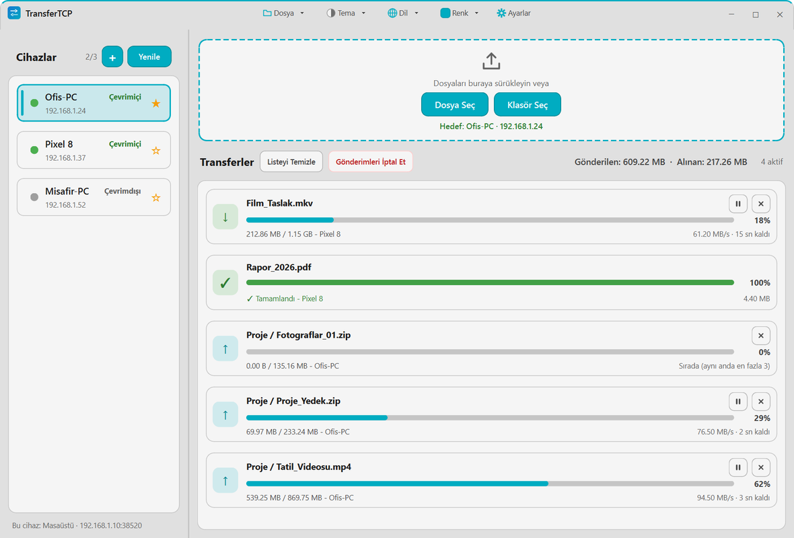
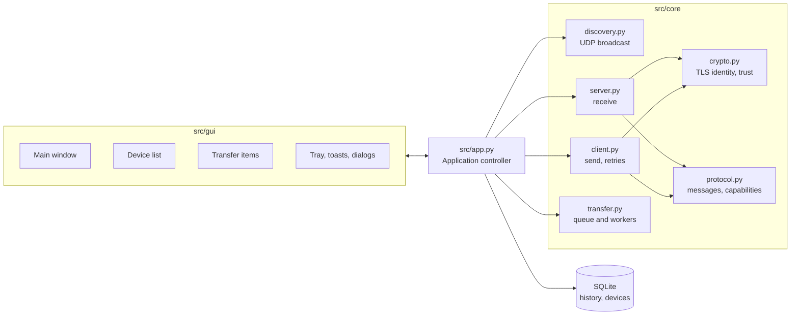

<div align="center">

# TransferTCP

**Send files and folders between computers on the same network. No account, no cloud.**

[English](README.md) | [Türkçe](README.tr.md)


<picture>
  <source media="(prefers-color-scheme: dark)" srcset="docs/images/transfertcp-dark.webp">
  <source media="(prefers-color-scheme: light)" srcset="docs/images/transfertcp-light.webp">
  
</picture>

<sub>Screenshots show the Turkish interface with sample data.</sub>

</div>

## Highlights

- **Finds other devices by itself.** Computers running TransferTCP on the same network show up in the device list; you can also add one by IP address.
- **Encrypted.** Transfers run over TLS 1.3. The first time a device sends you something, you decide whether to trust it.
- **Robust.** Interrupted transfers are retried and resume from the partial file. A SHA-256 check confirms the received file, and a half-received file never replaces the real one.
- **In your control.** Pause, resume and cancel; speed limit, concurrent-transfer limit and chunk size are settings; waiting transfers are listed as queued.
- **Folders included.** Drag files or whole folders onto the window; folders arrive with their inner structure.
- **Stays out of the way.** Closing the window hides the app in the system tray; optional start at login.
- **Looks the way you want.** Light, dark or system theme, ten accent colors, Turkish and English.

## Features

### Transfers

| Feature | Details |
|---|---|
| Device discovery | UDP broadcast on the local network; devices that stop answering are marked offline. Favorites (star) and manual add by IP address and port. |
| Sending | Drag and drop, or **Select File** / **Select Folder**. A target must be selected first; while no online device is selected the send controls are disabled. |
| Receiving | Files go to the download folder you choose. An existing file with the same name is replaced atomically only if **Overwrite Files with the Same Name** is on (it is by default); otherwise, or if the target is locked, the new file is saved as `name (1).ext`. |
| Reliability | Automatic retries after a dropped connection, resume from the partial `.part` file, SHA-256 verification of the finished file. |
| Control | Pause, resume and cancel a transfer; **Cancel Transfers** cancels everything active (the button appears when more than three transfers are active). Speed limit in MB/s (0 = unlimited), 1 to 10 concurrent transfers, 512 KB to 4 MB chunk size. |
| History | Finished transfers are stored in a local SQLite database and can be viewed (**Ctrl+H**) and cleared. |

### Application

| Feature | Details |
|---|---|
| Tray | Closing the window (X) hides it to the tray. Quit with **Ctrl+Q**, **File > Exit** or the tray menu. A tray menu offers Show/Hide, Settings, Theme, Language and Exit. |
| Notifications | Desktop notifications when a file or folder transfer finishes or fails, and for trust requests, shown while the window is not in the foreground. Can be turned off. |
| Start at login | **Start at Login** setting, off by default. Optionally start minimized to the tray. |
| Appearance | Theme, language and accent color can be changed from the title bar or from Settings, where the choice is previewed live and reverts on Cancel. |
| First run | A single welcome window asks for the device name and download folder. Closing it keeps the computer name and the Downloads folder. |
| Single instance | Starting a second copy brings the running window to the front. |
| Updates | Daily update check, optional automatic install, server notices. See [Updates and notices](#updates-and-notices). |

## Installation

### Official binary

A single-file Windows build is available from **https://macik.com.tr**. It needs no installation. Run it on both computers. If Windows Defender Firewall asks on first start, allow access on **private networks**.

### From source

Requires Python 3.12 and a desktop session.

```bash
git clone https://github.com/Aseloth99/transfertcp.git
cd transfertcp
python -m pip install -r requirements.txt
python main.py
```

`python main.py --minimized` starts the app hidden in the tray.

## Usage

1. Start TransferTCP on both computers (same local network).
2. Pick the other computer in the **Devices** list on the left. Use **+** to add one by IP address if it is not listed (for example on a different subnet), and **Refresh** to rescan.
3. Drop files or folders on the drop zone, or use **Select File** / **Select Folder**.
4. On the receiving computer, confirm the trust request the first time (the dialog shows the sender's fingerprint). Later transfers from a trusted device need no confirmation.
5. Watch progress in the transfer list. Use the pause and cancel buttons on an item, **Clear List** to remove finished entries, or **Cancel Transfers** to stop everything that is active.

After the first run the app starts hidden in the tray by default (**Start Minimized to System Tray**). Click the tray icon, or start the program a second time, to bring the window up.

### Keyboard shortcuts

| Shortcut | Action |
|---|---|
| `Ctrl+O` | Send File (File menu) |
| `Ctrl+H` | Transfer History |
| `Ctrl+,` | Settings |
| `F1` | About |
| `Ctrl+Q` | Quit the application (the window's X only hides it) |

### Settings

| Tab | Options |
|---|---|
| General | Device name; theme and language; **Start at Login**, **Start Minimized to System Tray** (on by default); desktop notifications. |
| Transfer | Download folder; transfer port (1024 to 65535, default 38520); chunk size; speed limit; concurrent transfers; **Automatically Open File After Transfer**; **Overwrite Files with the Same Name**. |
| Network & Advanced | Logging and log level; transfer history; **Check for Updates Automatically**, **Install Updates Automatically**; **End-to-End Encryption (TLS 1.3)**; **Accept Files from Anyone Without Asking** (off by default); **Clear Trusted Devices**. |

The configuration file is `config.json` in the per-user application folder (`%APPDATA%\TransferTCP` on Windows). A `config.json` next to the program is only read once, as a seed, when no user configuration exists yet.

## Network and security

| Item | Value |
|---|---|
| Transfers | TCP, port 38520 by default (changeable in Settings). |
| Discovery | UDP broadcast, port 38521; if it is busy the app falls back to 38522, then 38523. |
| Encryption | After a JSON handshake that negotiates capabilities, the connection is upgraded to TLS 1.3 when both sides allow it. |
| Trust | Each device presents a fingerprint, a SHA-256 hash of local hardware and OS identifiers. It is advertised during discovery and shown in the trust dialog. The first contact needs your approval; a device whose identity changes is flagged. |

TLS uses a self-signed certificate generated on first run and no certificate authority, so protection rests on you approving the fingerprint the first time. Treat it as a tool for networks you trust. Turning encryption off in Settings sends data in plain TCP.

## Updates and notices

- Once a day (if **Check for Updates Automatically** is on) the app asks `macik.com.tr` whether a newer version exists. An **Update · vX** button appears in the title bar and tray menu when one does.
- Downloads are accepted only over HTTPS from `macik.com.tr` and are checked against the SHA-256 checksum supplied by the server. The running executable is then swapped and the app restarts. If the new version fails to start twice in a row, the previous executable is restored and that version is not offered again.
- With **Install Updates Automatically** the update is installed silently while the app is idle (no active transfers, no open dialog, main window hidden or minimized), and only if the server supplied a checksum. Otherwise the update button opens a dialog with the release notes.
- In-app installation works for the packaged Windows executable. A copy running from source only reports that an update exists.
- The server can also publish a one-line notice. It appears at the top of the window and can be dismissed with its close button.

## Architecture



```text
main.py                  entry point: single-instance lock, DPI, crash log, start/stop wiring
src/
  app.py                 Application controller: connects core components and GUI
  core/
    discovery.py         UDP presence broadcasts, device table, manual devices
    server.py            TCP listener: handshake, trust approval, receive, resume, integrity
    client.py            Sender: handshake, TLS upgrade, chunks, retries
    transfer.py          Transfer queue and worker threads
    protocol.py          Length-prefixed JSON messages, capability negotiation
    crypto.py            Device certificate, TLS 1.3 contexts, fingerprint, trust store
    netio.py             Socket helpers (keepalive, listen sockets, exact reads)
  models/                Device and Transfer models, SQLite database
  gui/                   Main window, device list, transfer items, settings, dialogs, tray, toasts
  utils/
    config.py, paths.py  Settings and per-user folders (Windows, macOS, Linux)
    locales.py           Turkish and English strings
    updater.py           Update check
    update_installer.py  Download, SHA-256 check, install
    self_update.py       In-process executable swap with rollback
    update_policy.py     URL and checksum rules for updates
    remote_notice.py     Server notice parsing
    startup.py           Start at login (Windows Run key; macOS and Linux via autostart_unix.py)
    notify.py            Desktop notifications
tests/                   unittest suite (isolated user folders, loopback sockets, no real registry writes)
assets/                  Icons and QSS themes (dark, light)
```

## Build

```bash
python -m pip install -r requirements-build.txt
python -m PyInstaller TransferTCP.spec --noconfirm --clean
```

The single-file executable is written to `dist/TransferTCP.exe`. The spec embeds `assets/` and the icon, and `file_version_info.txt` provides the Windows version resource (its version must match `UpdateChecker.CURRENT_VERSION` in `src/utils/updater.py`; a test checks that).

## Tests

```bash
python -X utf8 -m unittest discover -s tests
```

The tests use the Qt offscreen platform, redirect the user's application folders to a temporary directory, bind loopback sockets only and block writes to the real Windows registry. Some tests are skipped on Windows because they cover POSIX-only behavior.

## Platform support

Windows is the primary platform and the only one the project is run on. The macOS and Linux code paths (configuration folders, start at login, notifications) are covered by unit tests with fakes but have never been run on those systems; treat them as experimental. In-app self-update is Windows-only.

## License

The source code is released under the [MIT License](LICENSE).

TransferTCP uses PyQt6, which is available under GPL-3.0 or a commercial license. The source code here is MIT; if you distribute binaries, PyQt6's license terms apply to them. TLS and certificate handling use the [cryptography](https://cryptography.io) package.
