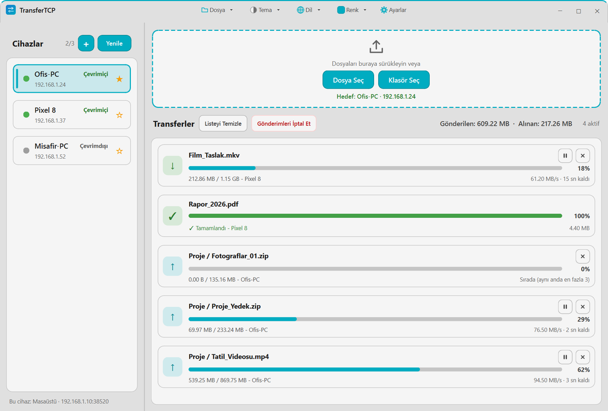
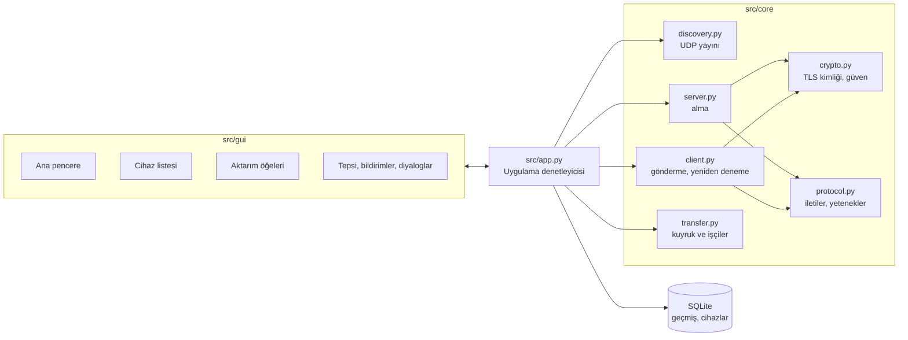

<div align="center">

# TransferTCP

**Aynı ağdaki bilgisayarlar arasında dosya ve klasör gönderin. Hesap yok, bulut yok.**

[English](README.md) | [Türkçe](README.tr.md)


<picture>
  <source media="(prefers-color-scheme: dark)" srcset="docs/images/transfertcp-dark.webp">
  <source media="(prefers-color-scheme: light)" srcset="docs/images/transfertcp-light.webp">
  
</picture>

<sub>Ekran görüntüleri örnek verilerle hazırlanmıştır.</sub>

</div>

## Öne Çıkanlar

- **Cihazları kendiliğinden bulur.** Aynı ağda TransferTCP çalıştıran bilgisayarlar cihaz listesinde görünür; istediğiniz cihazı IP adresiyle de ekleyebilirsiniz.
- **Şifreli.** Aktarımlar TLS 1.3 üzerinden yapılır. Bir cihaz size ilk kez bir şey gönderdiğinde güvenip güvenmeyeceğinize siz karar verirsiniz.
- **Sağlam.** Kopan aktarım yeniden denenir ve yarım dosyadan devam eder. Alınan dosya SHA-256 ile doğrulanır; yarım kalan dosya asıl dosyanın yerine geçmez.
- **Denetim sizde.** Aktarımı duraklatın, sürdürün, iptal edin; hız sınırı, aynı anda aktarım sayısı ve parça boyutu ayardır; bekleyenler "Sırada" olarak ayrı görünür.
- **Klasörler dahil.** Dosyaları ya da klasörleri pencereye sürükleyin; klasör iç yapısıyla birlikte gider.
- **Yolunuza çıkmaz.** Pencereyi kapatmak uygulamayı sistem tepsisine gizler; isterseniz oturum açılışında kendiliğinden başlar.
- **Görünüm sizin seçiminiz.** Açık, koyu ya da sistem teması, on vurgu rengi, Türkçe ve İngilizce.

## Özellikler

### Aktarım

| Özellik | Ayrıntı |
|---|---|
| Cihaz bulma | Yerel ağda UDP yayını; yanıt vermeyen cihazlar çevrimdışı işaretlenir. Favori (yıldız) ve IP adresi ile port girerek elle ekleme. |
| Gönderme | Sürükle-bırak ya da **Dosya Seç** / **Klasör Seç**. Önce bir hedef seçilmelidir; çevrimiçi bir cihaz seçili değilken gönderme denetimleri pasiftir. |
| Alma | Dosyalar seçtiğiniz indirme klasörüne gider. Aynı adlı dosyanın üzerine yalnızca **Aynı Adlı Dosyanın Üzerine Yaz** açıksa (varsayılan açık) atomik olarak yazılır; kapalıysa ya da hedef kilitliyse yeni dosya `ad (1).uzanti` adıyla kaydedilir. |
| Güvenilirlik | Bağlantı kopunca otomatik yeniden deneme, yarım `.part` dosyasından devam, biten dosyanın SHA-256 ile doğrulanması. |
| Denetim | Aktarımı duraklatma, sürdürme, iptal etme; **Gönderimleri İptal Et** süren her şeyi iptal eder (düğme üçten fazla aktarım sürerken görünür). Hız sınırı MB/s (0 = sınırsız), aynı anda 1 ile 10 aktarım, 512 KB ile 4 MB parça boyutu. |
| Geçmiş | Biten aktarımlar yerel bir SQLite veritabanında saklanır; **Ctrl+H** ile görülür, istenince temizlenir. |

### Uygulama

| Özellik | Ayrıntı |
|---|---|
| Tepsi | Pencereyi kapatmak (X) onu tepsiye gizler. Çıkmak için **Ctrl+Q**, **Dosya > Çıkış** ya da tepsi menüsündeki **Çıkış** kullanılır. Tepsi menüsünde Göster/Gizle, Ayarlar, Tema, Dil ve Çıkış vardır. |
| Bildirimler | Bir dosya ya da klasör aktarımı bittiğinde veya başarısız olduğunda ve güven isteklerinde, pencere ön planda değilken masaüstü bildirimi verilir. Kapatılabilir. |
| Açılışta başlatma | **Açılışta Başlat** ayarı, varsayılan kapalı. İsteğe bağlı olarak tepside küçültülmüş başlar. |
| Görünüm | Tema, dil ve vurgu rengi başlık çubuğundan ya da Ayarlar'dan değiştirilir; Ayarlar'da seçim pencerede anında denenir, İptal edilirse eski görünüme dönülür. |
| İlk açılış | Tek bir karşılama penceresi cihaz adını ve indirme klasörünü sorar. Pencereyi kapatırsanız bilgisayar adı ve İndirilenler klasörüyle devam edilir. |
| Tek kopya | İkinci kez başlatmak, çalışan pencereyi öne getirir. |
| Güncelleme | Günde bir güncelleme denetimi, isteğe bağlı otomatik kurulum, sunucu duyuruları. [Güncelleme ve duyurular](#güncelleme-ve-duyurular) bölümüne bakın. |

## Kurulum

### Resmî ikili

Tek dosyalık Windows sürümü **https://macik.com.tr** adresinde bulunur. Kurulum gerektirmez; iki bilgisayarda da çalıştırın. Windows Güvenlik Duvarı ilk açılışta izin isterse **özel ağlar** için izin verin.

### Kaynaktan

Python 3.12 ve bir masaüstü oturumu gerekir.

```bash
git clone https://github.com/Aseloth99/transfertcp.git
cd transfertcp
python -m pip install -r requirements.txt
python main.py
```

`python main.py --minimized` uygulamayı tepside gizli başlatır.

## Kullanım

1. TransferTCP'yi iki bilgisayarda da (aynı yerel ağda) başlatın.
2. Soldaki **Cihazlar** listesinden öbür bilgisayarı seçin. Listede yoksa (örneğin farklı bir alt ağdaysa) **+** ile IP adresiyle ekleyin, yeniden taramak için **Yenile**'yi kullanın.
3. Dosyaları ya da klasörleri bırakma alanına sürükleyin veya **Dosya Seç** / **Klasör Seç** düğmelerini kullanın.
4. Alıcı bilgisayarda ilk seferde güven isteğini onaylayın (pencere göndericinin parmak izini gösterir). Güvenilen bir cihazdan sonraki aktarımlar onay istemez.
5. İlerlemeyi aktarım listesinden izleyin. Bir öğedeki duraklat ve iptal düğmelerini, biten kayıtları kaldırmak için **Listeyi Temizle**'yi, süren her şeyi durdurmak için **Gönderimleri İptal Et**'i kullanın.

İlk açılıştan sonra uygulama varsayılan olarak tepside gizli başlar (**Başlangıçta Sistem Tepsisine Küçült**). Pencereyi getirmek için tepsi simgesine tıklayın ya da programı ikinci kez başlatın.

### Klavye kısayolları

| Kısayol | İşlem |
|---|---|
| `Ctrl+O` | Dosya Gönder (Dosya menüsü) |
| `Ctrl+H` | Transfer Geçmişi |
| `Ctrl+,` | Ayarlar |
| `F1` | Hakkında |
| `Ctrl+Q` | Uygulamadan çık (pencerenin X'i yalnızca gizler) |

### Ayarlar

| Sekme | Seçenekler |
|---|---|
| Genel | Cihaz adı; tema ve dil; **Açılışta Başlat**, **Başlangıçta Sistem Tepsisine Küçült** (varsayılan açık); masaüstü bildirimleri. |
| Transfer | İndirme klasörü; transfer portu (1024 ile 65535, varsayılan 38520); parça boyutu; hız sınırı; eşzamanlı transfer; **Transfer Bitince Dosyayı Otomatik Aç**; **Aynı Adlı Dosyanın Üzerine Yaz**. |
| Ağ ve Gelişmiş | Günlük tutma ve günlük seviyesi; transfer geçmişi; **Güncellemeleri Otomatik Kontrol Et**, **Güncellemeleri Otomatik Kur**; **Uçtan Uca Şifreleme (TLS 1.3)**; **Herkesten Soru Sormadan Dosya Kabul Et** (varsayılan kapalı); **Güvenilen Cihazları Temizle**. |

Yapılandırma dosyası, kullanıcıya özel uygulama klasöründeki `config.json` dosyasıdır (Windows'ta `%APPDATA%\TransferTCP`). Programın yanındaki bir `config.json`, yalnızca kullanıcı yapılandırması henüz yokken bir kez tohum olarak okunur.

## Ağ ve güvenlik

| Öğe | Değer |
|---|---|
| Aktarım | TCP, varsayılan port 38520 (Ayarlar'dan değiştirilebilir). |
| Cihaz bulma | UDP yayını, port 38521; meşgulse sırayla 38522 ve 38523'e geçilir. |
| Şifreleme | Yetenekleri anlaşan bir JSON el sıkışmasından sonra, iki taraf da izin veriyorsa bağlantı TLS 1.3'e yükseltilir. |
| Güven | Her cihaz bir parmak izi sunar: yerel donanım ve işletim sistemi tanımlayıcılarının SHA-256 özeti. Cihaz bulma sırasında ağda duyurulur ve güven penceresinde gösterilir. İlk temas onayınızı ister; kimliği değişen cihaz uyarılır. |

TLS, ilk çalıştırmada üretilen kendinden imzalı bir sertifika kullanır ve bir sertifika otoritesi yoktur; koruma, parmak izini ilk seferde sizin onaylamanıza dayanır. Güvendiğiniz ağlar için bir araç olarak düşünün. Ayarlar'dan şifrelemeyi kapatırsanız veri düz TCP ile gider.

## Güncelleme ve duyurular

- **Güncellemeleri Otomatik Kontrol Et** açıksa günde bir kez uygulama `macik.com.tr`'ye yeni sürüm olup olmadığını sorar. Varsa başlık çubuğunda ve tepsi menüsünde **Güncelle · vX** düğmesi çıkar.
- İndirmeler yalnızca `macik.com.tr` üzerinden HTTPS ile kabul edilir ve sunucunun verdiği SHA-256 sağlama toplamıyla denetlenir. Ardından çalışan exe değiştirilir ve uygulama yeniden başlar. Yeni sürüm arka arkaya iki kez açılışta başarısız olursa önceki exe geri gelir ve o sürüm bir daha önerilmez.
- **Güncellemeleri Otomatik Kur** açıkken güncelleme, uygulama boştayken (süren aktarım yok, açık pencere ya da diyalog yok, ana pencere gizli ya da simge durumunda) sessizce kurulur ve yalnızca sunucu bir sağlama toplamı verdiyse. Aksi halde güncelleme düğmesi sürüm notlarıyla bir pencere açar.
- Uygulama içi kurulum, paketlenmiş Windows çalıştırılabilir dosyası için çalışır. Kaynaktan çalışan kopya yalnızca güncelleme olduğunu bildirir.
- Sunucu ayrıca tek satırlık bir duyuru yayımlayabilir. Pencerenin üstünde görünür ve kapatma düğmesiyle kapatılır.

## Mimari



```text
main.py                  giriş noktası: tek kopya kilidi, DPI, çökme günlüğü, başlatma/durdurma bağlantıları
src/
  app.py                 Uygulama denetleyicisi: çekirdek bileşenleri ve arayüzü bağlar
  core/
    discovery.py         UDP varlık yayınları, cihaz tablosu, elle eklenen cihazlar
    server.py            TCP dinleyici: el sıkışma, güven onayı, alma, devam, bütünlük
    client.py            Gönderici: el sıkışma, TLS yükseltme, parçalar, yeniden deneme
    transfer.py          Aktarım kuyruğu ve işçi iş parçacıkları
    protocol.py          Uzunluk önekli JSON iletileri, yetenek anlaşması
    crypto.py            Cihaz sertifikası, TLS 1.3 bağlamları, parmak izi, güven deposu
    netio.py             Soket yardımcıları (keepalive, dinleme soketleri, tam okuma)
  models/                Cihaz ve Transfer modelleri, SQLite veritabanı
  gui/                   Ana pencere, cihaz listesi, aktarım öğeleri, ayarlar, diyaloglar, tepsi, bildirimler
  utils/
    config.py, paths.py  Ayarlar ve kullanıcıya özel klasörler (Windows, macOS, Linux)
    locales.py           Türkçe ve İngilizce metinler
    updater.py           Güncelleme denetimi
    update_installer.py  İndirme, SHA-256 denetimi, kurulum
    self_update.py       Geri alma destekli, süreç içi exe değiştirme
    update_policy.py     Güncelleme için adres ve sağlama toplamı kuralları
    remote_notice.py     Sunucu duyurusunun ayrıştırılması
    startup.py           Açılışta başlatma (Windows Run anahtarı; macOS ve Linux autostart_unix.py ile)
    notify.py            Masaüstü bildirimleri
tests/                   unittest paketi (yalıtılmış kullanıcı klasörleri, loopback soketleri, gerçek kayıt defterine yazma yok)
assets/                  Simgeler ve QSS temaları (koyu, açık)
```

## Derleme

```bash
python -m pip install -r requirements-build.txt
python -m PyInstaller TransferTCP.spec --noconfirm --clean
```

Tek dosyalık çalıştırılabilir dosya `dist/TransferTCP.exe` olarak yazılır. Spec dosyası `assets/` klasörünü ve simgeyi gömer; Windows sürüm kaynağını `file_version_info.txt` sağlar (sürümü `src/utils/updater.py` içindeki `UpdateChecker.CURRENT_VERSION` ile aynı olmalıdır; bir test bunu denetler).

## Testler

```bash
python -X utf8 -m unittest discover -s tests
```

Testler Qt'nin offscreen platformunu kullanır, kullanıcının uygulama klasörlerini geçici bir dizine yönlendirir, yalnızca loopback soketlerine bağlanır ve gerçek Windows kayıt defterine yazmayı engeller. Yalnızca POSIX'te geçerli davranışları sınayan bazı testler Windows'ta atlanır.

## Platform desteği

Windows birincil platformdur ve proje yalnızca orada çalıştırılmıştır. macOS ve Linux kod yolları (yapılandırma klasörleri, açılışta başlatma, bildirimler) sahte nesnelerle birim testlerinden geçer ama o sistemlerde hiç çalıştırılmamıştır; deneysel sayın. Uygulama içi kendini güncelleme yalnızca Windows'ta vardır.

## Lisans

Kaynak kod [MIT Lisansı](LICENSE) ile yayımlanmıştır.

TransferTCP, GPL-3.0 ya da ticari lisansla sunulan PyQt6'yı kullanır. Buradaki kaynak kod MIT'tir; ikili dosya dağıtırsanız bunlara PyQt6'nın lisans koşulları uygulanır. TLS ve sertifika işlemleri [cryptography](https://cryptography.io) paketini kullanır.
